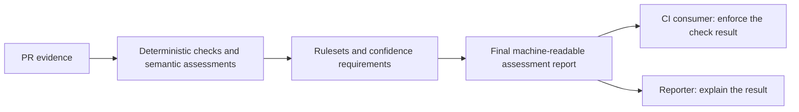

# PR communication quality specification

## Purpose and scope

The intended product is a CI quality check for a PR's title and description:
evaluate configured criteria, consistency between title and description, and
accuracy and completeness against the actual supplied changes. Patches are
evidence for those comparisons. Assessing code correctness, security defects,
or implementation improvements is outside this check's scope.

The existing decider adapters, deterministic checks, semantic assessment rubric,
confidence provenance, and evidence validation power the new assessment runtime.
The legacy `review` and `evaluate` commands retain an advisory routing pipeline
with a review stage. That stage can influence routing, and the optional Ollama review adapter
explicitly assesses code defects; neither is the intended reporter.

The `assess` command implements the communication decision without a reviewer
or reporter. Its new `AssessmentReport` schema version 1 is independent of the
legacy `ReviewReport` schema version 4. Legacy commands, policies, prompts,
fixtures, labels, and recording fingerprints retain their behavior. The default
mode remains offline; local and hosted inference require explicit selection.
Reporter generation and consumer CI enforcement are still planned.

## Intended PR communication check

### Decision and reporting responsibilities

The **decider** (decision provider) assesses semantic criteria alongside explicit
deterministic checks. The **engine** applies the configured rulesets and
confidence requirements to determine the check result. Deterministic checks
establish format or other programmatic requirements; semantic assessments judge
meaning, including meaningful titles, rationale, and consistency with changes.
Change/triviality classification may select communication requirements without
establishing code safety.

The final assessment report is the authority for the CI consumer. It must retain
gate results, criterion identifiers and statuses, blocking reasons, suggestions,
unresolved evidence, and confidence provenance, including early deterministic
failures where no model ran. `AssessmentReport` now supplies this final machine
result. Legacy review experiments still store their separate rubric assessments
in experiment artifacts alongside `ReviewReport`.

The **reporter** consumes that finalized report and communicates it to a human.
It explains which criteria failed or remain unresolved and what could improve
the title or description. It may make educated interpretations of likely issues,
but must distinguish recorded assessment facts from qualified hypotheses. It
must not invent a rejection reason, claim tests were run, or independently
review the code. It cannot alter the decision, criterion statuses, confidence,
or CI status. It must cover direct rejection and preflight failure as well as
acceptance, suggestions, and unresolved assessment. Reporter failure preserves
the machine result and permits a deterministic rendering of the recorded facts.

### Acceptance and CI meaning

Acceptance applies only to this check's configured communication requirements.
It requires **all applicable gates to pass, with no unresolved relevant
evidence**, under the configured rules and confidence requirements. Evidence is
relevant when needed to resolve an applicable gate. Irrelevant unknowns do not
justify expanding the check into a code review.

Non-blocking suggestions can accompany passing gates; they cannot compensate for
a failed gate or unresolved relevant evidence. A failed gate yields a blocking
failure. Unresolved relevant evidence prevents acceptance and remains explicit
for resolution; it is not an observed failure of the PR's claims. No average
score, fluent explanation, or unsupported confidence claim can override these
conditions.

The following illustrate the communication gate semantics. Actual semantic
judgments depend on the configured decider and remain subject to its limitations:

| Evidence and configured requirements | Check result and explanation |
| --- | --- |
| Meaningful title and accurate description agree with complete changes; every applicable gate passes | Acceptance for this check only. |
| Every applicable gate passes; an advisory testing-explanation criterion suggests more detail | Non-blocking suggestion; passing gates remain passing. |
| Description claims a default is unchanged, but the patch changes it and accuracy is required | Blocking failure identifying the contradiction. |
| An accuracy gate needs a missing or truncated patch, even though title syntax passes | Unresolved relevant evidence; acceptance is unavailable. |
| Title and description name different changes and consistency is required | Blocking failure identifying the conflicting claims. |
| A description omits a changed configuration setting and complete coverage is required | Blocking failure identifying the omission. |

A future CI consumer enforces the finalized result independently of reporter
generation. Passing this check is not a GitHub approval, permission to merge, or
an assessment of code correctness. Consumer integration and reporter generation
remain separate future work. `assess` uses the following exit contract:

| Exit code | Assessment result | Suggested CI handling |
| --- | --- | --- |
| `0` | Accepted without suggestions | Success |
| `3` | Accepted with suggestions | Success with warnings |
| `1` | Rejected | Failure |
| `4` | Unresolved | Block acceptance pending resolution |
| `2` | Invalid invocation, configuration, input, replay, or output error | Failure |

Code `3` is nonzero: CI must explicitly map it to success with warnings rather
than relying on the shell's default failure handling. Reports are written before
returning an assessment status; output failures return `2` instead. Legacy
`review` and `evaluate` retain their existing exit behavior.

Its reports retain `automation_authorized: false`; native values do not establish
task calibration.

### Transition and benchmark reuse

The assessment-only runtime and communication benchmark now coexist with legacy
review routing. They stop at the final machine-readable report: no mock reporter
is constructed. Consumer CI enforcement and reporter generation remain future
increments; no `--reporter` flag or provider alias is introduced.

The [synthetic corpus](../examples/synthetic-prs/README.md#communication-quality-benchmark)
supplies existing title/description annotations to the separately versioned
`communication-v1` benchmark. Supplied review text and `review-coverage` are legacy
dimensions and must not affect that benchmark's communication decisions.
Preserve evidence, case identities, family splits, labels and reference history;
extend annotations only where required communication criteria lack suitable
labels. Existing label adjudications apply only where their criterion definitions
match. Labels remain provisional until human validation, and reference
annotations must never enter model inputs.

## Communication assessment runtime

`pr-review-router assess --input PATH --assessment-rubric PATH` requires an
explicit, non-empty JSON/TOML assessment rubric. Reuse the existing question
formats, numeric bands, choice-confidence abstention, ordered enforcement rules,
and `any_of` alternatives. Supplied-review targets are rejected. Semantic
questions receive only PR evidence; reference annotations and legacy supplied
reviews are never model input. Instructions assess communication against changes,
not code correctness.

`assess_pull_request(evidence, policy, rubric, assessment_provider=None)` returns
`AssessmentReport` from `assessment_engine.py`. The optional provider supplies a
`CriterionBatch` containing ordered criterion results, effective choice labels,
and provider identity. Missing providers leave semantics uncertain. Existing
`RubricDecisionProvider.assess()` now exposes these results directly; legacy
`decide()` still reduces them to the same historical routing recommendation.

Report version `"1"`, identified by `report_type: "pr_communication"`, includes:

- PR repository/number and base/head identifiers; `advisory_only: true` and
  `automation_authorized: false`.
- `verdict`: `accepted`, `rejected`, or `unresolved`; `suggestions` are separate.
- `coverage`, `pr_text`, `nonsemantic_checks`, and `policy_rubric` results.
- Complete ordered `criteria`, confidence provenance, native answers, `gates`,
  the zero-based `selected_enforcement_rule`, `blockers`, relevant `unresolved`
  gate IDs, safe `diagnostics`, and provider identity.

Coverage, export integrity, and budgets remain mandatory preflight gates in this
version, including formal-only assessments. Known deterministic policy failures
reject; missing/incomplete evidence and unavailable check execution remain
unresolved. Preflight failure prevents model calls. Formal-only rubrics need no
model, metadata calls, or calibrated score. The offline semantic mock cannot
accept via editorial-change rules or synthetic decision markers.

Known failed gates take precedence over unresolved gates; both reason lists are
retained. Uncertainty in advisory-only criteria does not block acceptance. One
passing alternative satisfies an `any_of` gate. Unresolved rule selection produces
an unresolved applicability gate rather than assuming all criteria are required.
Earlier potentially matching rules are resolved before later ones are selected.
No average or legacy route-confidence score overrides failed/unresolved gates.

The `assess` CLI supports `--config`, `--output`, `--models-config`, `--profile`,
`--decider`, decision-only `--model-override`, `--experiment-output`, and mutually
exclusive `--record PATH` / `--replay PATH`. It does not accept `--reviewer` or
`--providers-config`. Catalog resolution validates the selected decider only;
unused reviewer selections and capabilities are not required. Legacy full-catalog
validation is unchanged. Structured-output Ollama LLM deciders remain supported,
with explicit self-reported numeric provenance and an stderr warning.

`run_assessment` from `assessment_runtime.py` instantiates only typed decision
adapters and returns the final report, separate provenance, and optional tape.
Formal-only rubrics construct no adapter. Provenance defaults to
`reports/assessment-PR_NUMBER-HEAD_HASH.json`. Outputs retain the CLI's atomic,
private writes and input-path protections. Schema failures receive one retry;
provider exceptions cannot expose raw response/exception content or silently pass
required semantics. Complete native probabilities and task confidence remain
separate; existing hosted consent, pinning, budgets, and transport safeguards apply.

Recordings use the isolated `pr-communication-v1` fingerprint namespace covering
PR evidence, policy, rubric, decider settings, prompts, adapters, and report schema.
They exclude reviewers and reference labels. Legacy tapes cannot be replayed as
assessment runs; mismatched, missing, or unused exchanges fail with status 2 and
never fall back to live inference. Hosted recording still requires separate
consent. Replaying needs no credentials or live clients.

The [communication benchmark](../examples/synthetic-prs/README.md#communication-quality-benchmark)
uses the same runtime with preserved canonical annotations. Benchmark version
`communication-v1` and reference version `author-communication-v1` retain
provisional author labels, frozen family splits, and independent provenance;
they do not replace legacy reference revisions or establish calibration.

## Evidence contract

All objects reject unknown fields and use strict types. Required evidence fields:

| Field | Meaning |
| --- | --- |
| `repository` | Nonempty repository identifier |
| `number` | Positive integer PR number |
| `base_sha`, `head_sha` | Nonempty supplied commit identifiers |
| `title` | Nonempty PR title |
| `files` | Changed-file list, with unique paths |

Optional `body` defaults to an empty string. `files_complete` defaults to true;
collectors must set it to false when pagination or exports omit files. Each file
requires `path`, `status` (`added`, `modified`, `removed`, or `renamed`), and
nonnegative integer `additions`/`deletions`. Optional `patch` defaults to null and
`patch_truncated` defaults to false.

Patches use unified diff hunks, optionally preceded by file headers. Validate
declared old/new hunk counts and aggregate added/deleted counts against the
metadata. Support new files, removed files, multiple hunks, context lines, and
the no-final-newline marker. Missing/binary patches, metadata-only changes,
truncation, malformed hunks, and count disagreements require human review.

Coverage means the supplied textual export passes these checks. It does not
verify repository contents or prove that a collector supplied every changed file.
No patch content is applied or executed.

## Policy

The TOML file contains top-level fields; partial configurations use defaults.

| Field | Default | Constraint |
| --- | ---: | --- |
| `skip_confidence` | 0.95 | Finite score in [0, 1] |
| `review_confidence` | 0.85 | Finite score in [0, 1] |
| `max_input_bytes` | 100000 | Positive integer |
| `max_files` | 100 | Positive integer |
| `max_findings` | 5 | Positive integer |
| `title_format` | `"any"` | `"any"` or `"conventional_commit"` |
| `required_body_sections` | `[]` | Unique, nonempty, trimmed, single-line section names |
| `rubric_minimum_score` | `70` | Finite score in [0, 100] |
| `rubric_criteria` | `[]` | List of unique, validated weighted criteria |
| `nonsemantic_checks` | `[]` | Unique deterministic regex or script checks |
| `check_timeout_seconds` | `10` | External-check timeout in seconds, from 1 through 60 |

When configured, `title_format = "conventional_commit"` requires a lowercase
type, an optional non-whitespace scope, an optional breaking-change marker, and
a colon followed by a nonempty description (for example,
`feat(router): validate PR descriptions`). `required_body_sections` names exact
level-two Markdown headings outside fenced code blocks, allowing Markdown's
0–3-space heading indentation. Each heading must have non-heading text beneath
it before the next level-one or level-two heading. For example,
`["Summary", "Testing"]` requires populated `## Summary` and `## Testing`
sections.

PR-text checks are disabled by default. They are deterministic format checks,
separate from patch coverage and provider review. A format failure is reported
under `pr_text` and hands the PR off to a human before any provider is called.
The checks do not verify that the description accurately describes the diff.

The optional rubric evaluates multiple title/body criteria independently.
Each criterion has a unique `criterion_id`, description, text field (`title` or
`body`), check (`non_empty`, `min_words`, `contains`, or `section_nonempty`),
positive weight, and blocker type (`hard` or `soft`). `min_words` uses
`minimum_words`; `contains` and `section_nonempty` use `value`. A minimum-word
criterion gets proportional credit up to 100; the other checks score 100 or 0.
Each criterion's `pass_score` defaults to 100 and it passes when its score is
greater than or equal to `pass_score`. The overall score is the weighted average
of criterion scores. Any failed hard criterion prevents an automated pass
regardless of the aggregate score. Soft criteria lower the aggregate score; a
score below `rubric_minimum_score` also requires human review. Individual
results and their deterministic explanations are included in `rubric`.

`nonsemantic_checks` adds deterministic policy gates without presenting them as
semantic review. A regex check has a unique `check_id`, `description`, `kind =
"regex"`, a `target` (`"title"`, `"body"`, `"patch"`, or `"file_paths"`), and a
Python regular-expression `pattern`. It passes when the pattern matches unless
`must_match = false` is configured. A script check has `kind = "script"` and a
nonempty TOML `command` array; the validated evidence JSON is sent to the
command's standard input, and exit status zero means pass. Regexes run in a worker process bounded by `check_timeout_seconds`. Commands are
started without a shell in an isolated process group and are bounded by the same
timeout; timeout terminates the command and its descendants.

Checks run after coverage and alongside the existing PR-text and rubric gates,
before either provider is called. Every result is included under
`nonsemantic_checks`; a failed, timed-out, or unstartable check requires the
configured unresolved outcome. Check output is not included in reports, which
avoids leaking script output or PR content.

The input budget measures the UTF-8 bytes of the validated evidence's compact
JSON representation, including metadata and patches. A budget violation prevents
provider invocation; evidence is never silently truncated.

Threshold comparisons are inclusive. An unavailable confidence value is always
zero and cannot authorize skipping or clearing review, even at a zero threshold.

## Optional direct and feedback routing

All options are independent and compose with coverage, PR-text and rubric gates.
See [runnable direct examples](../examples/direct/README.md).

| Policy field | Default | Values / meaning |
| --- | --- | --- |
| `allow_direct_acceptance` | false | Enable `accept` decision recommendations |
| `allow_direct_rejection` | false | Enable `reject` decision recommendations |
| `acceptance_confidence` | 0.95 | Inclusive finite score in [0, 1] |
| `rejection_confidence` | 0.95 | Inclusive finite score in [0, 1] |
| `review_behavior` | `"escalate"` | `"escalate"` or `"feedback"` |
| `feedback_depth` | `"standard"` | `"standard"` or `"deep"` |
| `acceptance_feedback` | false | Collect non-blocking review after direct acceptance |
| `unresolved_outcome` | `"needs_human_review"` | Human handoff or `"rejected"` with route `"blocked"` |

Enabled confident direct rejection stops before review. Direct acceptance stops
unless acceptance feedback is enabled. Disabled/low-confidence direct decisions
continue to review; unavailable confidence never permits direct decisions.
Feedback runs once at the configured depth, retains findings, and completes
regardless of reviewer outcome/confidence without escalation. It yields `feedback`
or preserves `accepted` after acceptance; feedback alone does not accept a PR.
Unresolved policy applies to failed gates, incomplete evidence, provider errors,
explicit human requests, and unresolved escalating review. A failed feedback
provider also follows unresolved policy. No failure can yield acceptance.
Existing skip recommendations and thresholds still apply before review.
All routes remain advisory and CLI successful report generation still exits 0;
consumers must enforce rejected outcomes as blocking.

## Provider roles, contracts, and confidence

The following are the current implemented interfaces. Use **decider** or
**decision provider** for the assessment role, **reporter** for the planned
explanation role, and **legacy review provider** for `ReviewProvider`.
Preserve these existing interface names until a separately specified migration;
renaming a diff assessor in prose does not give it the reporter contract.

| Term | Responsibility | Output |
| --- | --- | --- |
| Decision provider (`DecisionProvider`) | Recommends whether to skip review, begin review, or hand off to a human. It chooses a route; it does not assess whether the diff is correct. | `Decision`: recommendation, confidence, reason, and provider identity |
| Legacy review provider (`ReviewProvider`) | Assesses the diff at the requested review depth; its result can affect routing. It does not consume the finalized decision report. | `ReviewResult`: outcome, confidence, summary, provider identity, and findings |

The engine/router validates evidence, applies policy checks and thresholds,
sequences provider calls, and escalates unresolved results; it is not a model.
Optional PR-text checks and `Policy.rubric_criteria` scoring are deterministic
policy gates that run before providers. The separate assessment-rubric framework
also includes semantic questions answered by the decider. A human handles cases
the current automated route cannot resolve.

`standard` and `deep` are depth values passed to the review provider interface.
They are not two separate provider roles or necessarily different models. The
MVP uses one mock decision provider and one mock review provider; its `deep`
mock demonstrates the same interface and is not a stronger model.

Decision providers return a recommendation (`skip_review`, `review`,
`needs_human_review`, `accept`, or `reject`), confidence, reason, and provider identity. Review providers
accept a `standard` or `deep` depth and return an outcome (`no_concerns`,
`concerns`, or `uncertain`), confidence, summary, identity, and findings.

Confidence records its score and provenance: `mock`, `self_reported`,
`calibrated`, or `unavailable`. Calibrated scores require a calibration identifier.
The router uses scores according to policy; it does not calibrate them or assume
self-reported scores are probabilities.

Provider output is validated against these contracts at a single boundary
(`request_decision`/`request_review`). Providers may return models, dicts, or raw
JSON text; strict typing, enum values, confidence bounds, and required fields are
enforced and unknown fields are rejected. On a schema failure the call is retried
once (with `strict_schema=True` if the provider accepts that keyword). If the retry
is also invalid, the router requires human review and records only field locations
and error types, never provider output or exception text.

Findings include a changed-file path, optional positive new-side line, severity
(`low`, `medium`, `high`), title, and detail. Findings require a `concerns`
outcome. Unknown file references and invalid provider responses fail closed.
Line locations are supplied by providers; the engine does not validate their
semantic correctness.

## Routing and reporting

This is current legacy routing, preserved for compatibility. The review stage's
authority over escalation differs from the planned reporter's explanation-only
role. `skipped`, `reviewed`, and `accepted` here are existing advisory outcomes,
not evidence that the intended communication check has been fully implemented.

With the default policy, incomplete coverage goes directly to human review without provider calls.
A decision-provider recommendation of `needs_human_review` stops the pipeline.
A `skip_review` recommendation at or above the skip threshold skips review.

Other recommendations start review. Decision scores below the review threshold
or with unavailable provenance start at deep depth; otherwise review starts at
standard depth. A `no_concerns` result at or above the review threshold
completes the advisory review if no earlier review reported concerns. Otherwise
standard review escalates to deep review, and unresolved deep review requires
human review. Provider exceptions and malformed responses require human review;
exception text is excluded from reports.

Report schema version `"4"` includes:

- `advisory_only: true`, repository, PR number, base/head identifiers.
- `outcome`: `skipped`, `reviewed`, `needs_human_review`, `accepted`, `rejected`, or `feedback`.
- `route`: `no_review`, `standard`, `deep`, `human`, `direct`, `feedback`, or `blocked`.
- Reasons, coverage, optional decision, and executed review stages.
- `pr_text`, with whether policy checks are enabled, whether they pass, and any
  format issues.
- `nonsemantic_checks`, with whether checks are enabled and pass, plus each
  check's identifier, description, kind, result, and detail.
- `rubric`, with an optional weighted score, criterion scores/explanations,
  failed hard blockers, failed soft criteria, and whether the rubric passes.
- Deduplicated findings capped by policy and a unique `findings_omitted` count.

Version 3 added direct decisions and feedback outcomes/routes. Version 4 adds
the required `nonsemantic_checks` field; its contract rejects older schema
versions. Consumers of stored reports must retain an older parser or migrate
those reports before validation.

Stage finding lists are also capped individually. Escalation examines the complete
provider results before capping. Findings from earlier stages cannot be silently
discarded by a later clear response.

## Model catalog and selection precedence

Both CLI commands resolve providers independently of routing policy. Unless
`--providers-config PATH` is supplied, load explicit `--models-config PATH`,
otherwise `./models.toml`, otherwise the packaged `models.toml`. A missing
explicit file, unreadable local catalog, or invalid catalog fails with exit 2;
there is no silent fallback, parent search, or merge between catalogs.

Catalog `models` is a mapping of names to discriminated provider settings:
`mock` and structured-output `ollama` models are usable in either role;
`ollaya` and `jev` are only usable for decisions. Named variants may share the same underlying model. Settings
retain all existing validation and provider defaults; unknown fields are errors.
Every variant and profile is validated before any provider call. The catalog is
an editable registry of supported adapter configurations, not model discovery.
Shipped defaults select mock providers; live entries require available models
or hosted credentials. Listing a hosted entry does not call it.

Live catalog entries accept a `capabilities` table (inline or nested), separate
from provider runtime settings. System One capabilities fix `text_generation`
to false and `structured_output` to true; contradictory declarations are errors
even for unused entries. LLM capabilities fix `text_generation` to true and
accept an owner-declared `structured_output` boolean. Omitted capabilities
preserve the existing adapter assumptions (structured System One decisions or
structured LLM chat generation). Mocks retain their synthetic behavior without claiming
model capabilities. Declarations are not server discovery or evidence of quality.

Decision selection requires structured output and an implemented decision
adapter. Review selection requires text generation and an implemented review
adapter. Both Ollama role adapters require structured output: the decision
adapter implements the typed-question protocol using generated JSON, and the
review adapter requires JSON findings/confidence. A text-only LLM can be
registered but cannot be selected with these adapters. Invalid default, profile,
or explicit selections fail before HTTP calls or report writes.
Capabilities are stripped before constructing `ProvidersConfig`, cannot be
setting overrides, and do not alter runtime settings or replay fingerprints.
Legacy provider files keep their existing schema and behavior.

`[defaults]` contains `decider` and `reviewer` names (both default to `mock`).
`[profiles.NAME]` optionally replaces either role, inheriting the other from
catalog defaults. Names must exist and support their selected role. Selection
precedence is defaults, then `--profile`, then explicit `--decider` and
`--reviewer`, then repeated `--model-override ROLE.FIELD=TOML` settings.
The reviewer covers both standard/deep stages with the existing per-depth
budgets; this feature adds no ensemble or independent reviewer vote.
Overrides use role names `decision` and `review`, parse values as TOML, reject
duplicate keys and unknown fields, and cannot change `backend` or `model`.
The complete resolved configuration is revalidated after overrides.

Legacy `--providers-config` is a standalone configuration that bypasses catalog
loading and retains existing semantics. Combining it with any catalog option
is an error rather than an implicit merge. Policy environment precedence is
unchanged and does not apply to model settings. Automatically selected all-mock
defaults preserve original mock routing, including explicit direct-policy demos.
Any explicit catalog selection or non-mock default uses experiment safeguards,
including shadow skips and prohibition of direct decisions. Existing experiment
artifacts record complete resolved provider settings, so profile aliases do not
change fingerprints when effective settings are identical. Replay never falls
back to live inference. Catalog paths join existing protected source paths for
all outputs, including evaluation artifacts and derived experiment filenames.

## Local model experiments and replay

`review --providers-config PATH` selects providers separately from policy TOML
and its environment overrides. Without this option the model catalog described
above supplies the selections; shipped all-mock defaults retain mock behavior.
Each role independently selects `mock`, `ollaya`, hosted `jev`, or `ollama`
for decisions, and `mock` or `ollama` for review. Local adapters require an explicit installed
model and a loopback HTTP(S) origin without embedded credentials. Their remote
model prohibitions remain unchanged. The router does not manage models.
The endpoint/backend selection and model name are separate settings. Optional
`instructions` supplement the selected model's prompt; optional
`backend_instructions` handle backend-specific cases. Supplemental instructions
cannot replace adapter-owned evidence-safety, output-contract, uncertainty, or
advisory-only constraints. The Ollaya decision backend also accepts the
`max_choice_options` setting (default 3, range 2–100) as an upper bound on options
in any choice question, including semantic rubric questions.

Ollaya uses `POST /v1/systemone` with complete evidence and a choice among
`skip_review`, `review`, and `needs_human_review`. Context overflow or explicit
truncation fails closed. Reasons deterministically describe the selected label.
Native confidence/probabilities are retained separately; routing confidence is
`unavailable` until identifiable task calibration exists. Upstream model
calibration alone does not establish PR-routing calibration.

**Warning:** General LLM deciders are a non-optimal compatibility fallback.
Prefer a native System One decider (`ollaya` or `jev`) for the decision role.
Generated probabilities and confidence are self-reported, not native or
calibrated. Both `review` and `evaluate` print this warning once to stderr when
an LLM decider is selected, including through defaults, profiles, legacy files,
and replay. JSON output and exit status are unaffected. LLM reviewers alone
do not trigger the warning.

The Ollama decision adapter emulates the System One typed question interface
through `POST /v1/chat/completions` with strict JSON-schema output. It supports
batched choice (including custom labels), noul/predicate, and ordinal score
questions, for routing and assessment rubrics. Trusted question instructions and
criteria are in the system message; complete PR/review state is isolated in the
user message. The model authors only typed answer fields. Provider identity,
score legends, task-confidence provenance, and completion status are adapter-owned.

Runtime validation independently requires exact question IDs and types, configured
choice labels, finite bounded numbers, exact probability label sets, distributions
summing to one within 0.000001, and scores within their configured scale. Invalid
JSON, extra fields (including forged provenance), wrong types/labels, missing or
extra answers trigger the existing single schema retry, then conservative human
escalation. Refusal, tool use, incomplete generation, or a different answering
model cannot yield a decision. These failures have no System One or live fallback.

LLM numbers are generated self-reports, never native/logit probabilities or task
calibration. Task confidence remains `unavailable` (zero); normal experiment
shadow skips and escalation apply. LLM diagnostics and stored answer batches carry
`answer_source = "llm_self_reported"`; rubric `native_answer` retains its existing
container name but adds `source = "llm_self_reported"`, with an explicit explanation.
Existing criterion thresholds and confidence cutoffs apply conservatively to
these self-reports without establishing model calibration. Formal checks remain
deterministic and use their existing preflight and no-call behavior.

Both standalone `[decision] backend = "ollama"` and catalog LLM selections use
existing chat settings. `standard_max_tokens` reserves the output budget for the
whole decision batch; both configured output budgets must still fit context.
There is a fixed maximum of 100 categorical options per question. The context
check includes schema, instructions, state, template, framing, and reserved output.
Local inventory/digest/version checks and explicit matching `num_ctx` apply to the
decider too. Selection of the same LLM for both roles creates separate provider
instances/settings and does not provide independent corroboration.

LLM-only prompt/schema versions join the experiment fingerprint and adapter
revision when this adapter is selected. Existing native System One and reviewer
recordings keep their fingerprints and remain replayable. Experiment diagnostics
retain model metadata, self-reported answers, usage, and schema-failure counts.
Rubric timing includes only typed-decision generation requests, excluding reviewer
calls even when both use the same endpoint. Report schema version 4 is unchanged.

Ollama uses `POST /v1/chat/completions`, separate instructions and untrusted
evidence messages, JSON-schema output, and configurable generation settings.
The legacy review adapter prompts for concrete correctness defects. Its model
content contains outcome, numeric confidence, summary, and findings. This code
assessment is outside the intended communication check and remains documented
only to describe existing adapter behavior, not as a future reporter design.
Adapter code supplies identity and `self_reported` confidence provenance.
Existing response and changed-file validation applies. Refusal, incomplete
generation, a different answering model, or invalid output fails closed.
Standard/deep use distinct prompts and output budgets with the same model;
they do not constitute independent corroboration.

Before review generation `/api/show` must report explicit `num_ctx` matching
provider `context_tokens`. UTF-8 request/schema/template bytes, framing headroom,
and reserved output tokens must fit configured and architectural context
limits. This conservative check assumes byte-fallback tokenization and ordinary
templates; custom tokenizer/template adoption requires verification. It may
reject inputs that would fit after tokenization. Evidence is never silently
summarized or truncated. Model version/digest inspection happens lazily after
engine preflight, so failed gates prevent all HTTP calls.

Local HTTP requests have a total deadline and bounded bodies, ignore system proxies,
and do not redirect or automatically retry. The existing boundary catches schema
errors from adapter normalization as well as returned payloads and retries once
with `strict_schema=True`. Raw provider errors never enter advisory reports.

Experiments require `shadow_skips = true` and reject policies enabling direct
acceptance or rejection. A wrapper retains original validated decisions and
turns skip recommendations into review requests with an explicit reason, outside
the engine. Report schema remains version 4. Separate artifacts contain original
and native decisions, uncapped reviews, model metadata, generation settings,
prompt/schema revision, usage, timing, and schema/transport failure counts.

`review` supports `--record PATH`, `--replay PATH`, and `--experiment-output PATH`
with explicit provider configuration or catalog selection (or non-mock catalog
defaults). Artifact output defaults to
`reports/experiment-PR_NUMBER-HEAD_HASH.json`. Explicit recording writes a
version-1 tape containing origin, experiment fingerprint, and ordered HTTP
request/response or failure exchanges, including retry sequences. Private
runtime artifacts belong under ignored `reports/`; inspect and sanitize tapes
before committing them. Recording and replay are mutually exclusive.

Replay opens no HTTP client. Fingerprints cover provider/model settings, policy,
evidence, actual prompt contents/versions, and schemas. Every request and its
position must match. Header/request mismatches and missing/unused exchanges
produce status 2, even if the engine caught a replay exception and escalated.
There is no live fallback or implicit refresh.

`evaluate --corpus PATH [--providers-config PATH] [--config PATH]` runs validated
cases and writes per-case reports/artifacts and `summary.json` beneath
`--output-dir` (default `reports/evaluation`). `--record` writes case tapes;
`--replay-dir PATH` replays them. Corpus version 1 requires unique safe case IDs,
relative evidence paths beneath the corpus directory, categories, reference
routes, and expected concern anchors. Label status distinguishes provisional
from human-reviewed labels. Initial examples/tapes are explicitly provisional
and synthetic and do not claim model reviews.

The legacy local routing benchmark's metrics count unsafe original skips, missed
planted defects, findings unmatched by reference anchors, human handoffs,
schema/transport failures, and request latency. Path/optional-line matching of
uncapped native findings is a proxy
requiring human assessment. Replay uses recorded timing and does not assess
current model quality or speed. Preflight handoffs have no provider decision or
HTTP calls. Outputs are individually atomic/private; earlier case files can
remain after a later failure, and summary is written only after completion.
See [configuration and runnable commands](../examples/local-models/README.md).

## Hosted Jev Decisions and Rubrics

`decision.backend = "jev"` requires `allow_network = true`. The HTTPS endpoint
must be a credential-free origin without a path, query, or fragment; it defaults
to `https://api.typesafe.ai`. `model` defaults to `jev-1.14.0` and must be a pinned
`jev-MAJOR.MINOR.PATCH` identifier, never a moving alias. The resolved model must
match this pin. `api_key_env` names an environment variable (default
`TYPESAFE_API_KEY`); literal keys are not configuration fields and never enter
fingerprints, artifacts, or tapes. Credentials are read lazily after evidence
preflight. Hosted data handling must receive owner review before private PR use.

The adapter uses `TypeSafeClient.system_one()` from the synchronous Python SDK,
with a separate `httpx2` injection boundary from local `httpx` transports. One
client is reused within an experiment and closed afterward. Redirects, ambient
proxy configuration, compression, and SDK payload logging are disabled.
Timeouts default to 30 seconds per I/O operation. SDK retries default to two
after the initial attempt, with a 60-second retry budget and `Retry-After`
handling. The retry budget prevents scheduling over-budget retries and caps
attempt I/O timeouts to remaining time; it is not a process-level cancellation
deadline. Upstream errors and bodies are never included in failure reports.
Authentication, context, network, exhausted retries, malformed responses, and
response-budget failures yield no assessment and conservative human escalation.

`max_choice_options` defaults to 255 (range 3-255); local Ollaya limits do not
change. `max_request_bytes` defaults to 60000 (maximum 64000), including the
complete request. `max_question_bytes` defaults to 30000 (maximum 32000), including
the complete state and single-question envelope. These conservative UTF-8 byte
budgets leave headroom by default against Jev's documented 64k request/32k
question token limits; they are not an exact tokenizer. Server context failures
still fail closed. Long-context mode is not enabled. The response budget defaults
to 1048576 bytes. Evidence is never silently dropped, compressed into a summary,
or truncated to fit.

Routing and semantic rubric batches share `SystemOneDecisionProvider.evaluate`;
only local adapters inspect installed model inventory. Every requested answer
must be present with its expected type, including when the SDK skips unknown
answer kinds. SDK integer Score maps are serialized back to JSON string keys
before the existing strict rubric validator checks legends and distributions.
Resolved model, SDK version, request ID when supplied, native answers, usage,
and SDK attempt counts are retained in separate diagnostics. Choice/Score
confidence remains native distribution-derived evidence, not PR-task calibration;
Noul supplies only the proposition's yes-probability. Task confidence stays
unavailable and all skip recommendations remain shadowed. Human-reviewed PR
labels and identifiable task calibration are required before any later design
can enable automated skips. No calibration is claimed by this integration.

Hosted recording requires both `allow_recording = true` and an explicit record
command. Tapes omit authentication headers and upstream error bodies, but include
full request evidence and successful answers; only sanitized tapes may be shared.
They store one final bounded exchange per SDK call, with an `attempts` count and
schema-failure marker, rather than individual transient retry bodies. HTTP-call
metrics count attempts; timing includes SDK retry delays. Hosted fingerprints
also bind the SDK version and hosted adapter revision. Replay needs no credential,
opens no SDK client, reproduces recorded failures, and never falls back to the
network. Client setup failures are recorded without credentials as configuration
exchanges with zero HTTP attempts. Hosted response-schema failures retain a
sanitized schema marker and receive the provider boundary's single strict-schema
retry during both live execution and replay. Existing local tapes without the
optional exchange fields still load.
See [hosted examples](../examples/jev/README.md).

## Formal and semantic assessment rubric examples

An evaluation corpus can optionally name `assessment_rubric`, a relative JSON
or TOML path, and each case can supply a `review` path to UTF-8 review text. These inputs
must stay beneath the corpus directory and cannot be overwritten by outputs.
Rubric reference labels require a status for every configured criterion and an
expected recommendation. Existing corpora without these fields retain their
behavior and recording fingerprints. The loader selects JSON for a `.json`
suffix (case insensitive) and otherwise retains TOML parsing for existing paths.
Both formats use identical Pydantic validation. Fingerprints use the validated
rubric contents, so changing only the serialization format does not invalidate
HTTP recordings. This applies to assessment rubrics, including explicit
`--assessment-rubric` overrides; policy and provider configuration retain TOML.
The rubric document includes routing actions and thresholds in addition to the
semantic questions sent to the decision provider.

This experiment rubric is distinct from deterministic `Policy.rubric_criteria`.
It configures unique criterion IDs, descriptions, improvement messages, and checks
(`conventional_title`, `body_section`, or `semantic`). Without `enforcement_rules`,
each criterion also sets a failure `action` (`block` or `suggest`). With
`enforcement_rules`, criteria must not set `action`; the rules define enforcement.
Formal checks reuse existing title/section
validators. Without `enforcement_rules`, a formal blocker prevents all HTTP calls
and leaves semantic criteria explicitly unassessed. With enforcement rules, formal
results are evaluated like other criteria, because the enforced set may depend on
semantic condition criteria. Semantic criteria carry instructions and a
description/review target and use the configured Ollaya, Jev, or structured-output
Ollama decision adapter. Every
semantic question includes its configured description and criterion-specific
instructions, regardless of question type. The entire PR evidence and separately
supplied review are untrusted state data;
criterion instructions are separate. Description quality and consistency checks
are reusable for the intended scope. Supplied-review coverage is a legacy
experiment dimension, separate from assessing title/description quality; it is
not a requirement for the communication benchmark or an assessment of
the reporter. Current review-provider behavior is unchanged.

The synthetic PR rubric's `change-rationale` criterion requires a motivating
problem, need, or constraint distinct from a paraphrase of the change. Its paired
`good` and `what_not_why` fixtures guard that distinction with the same patch.
Its `description-coverage` criterion checks every changed file within one
assessment; any omitted substantive change fails, without requiring literal file
paths in the PR description. It first checks for a concrete edit claim in the
description body; without one, it returns `uncertain` before comparing coverage.
Its `review-coverage` criterion first distinguishes absent or unresolvable review
text (`uncertain`) from assessable but generic or partial review text (`failed`),
then checks each changed file within the same criterion.

Semantic criteria are batched through `/v1/systemone` for native adapters or
emulated with structured chat completions for Ollama. Each criterion selects
`question_type`: `choice` (default), `noul`, `predicate`, or `score`. `predicate`
is an alias for `noul`; Ollaya requests use its native `noul` type. By default,
choices return `passed`, `failed`, or `uncertain`. A semantic choice criterion may instead
configure a `choices` list, with two or more entries. Each entry has a unique
lowercase `label`, provider-visible `description`, and optional canonical
`status` of `passed`, `failed`, or `uncertain`. The selected decision provider's
`max_choice_options` capability limits the number of entries (Ollaya defaults to
3, range 2-100; Jev defaults to 255, range 3-255; Ollama supports up to 100). The
provider returns the custom label and its distribution. A
mapped label receives its configured status. An unmapped label remains available
to `routing_rules`; without a matching rule it maps conservatively to
`uncertain`.

A semantic choice or score criterion may set `uncertain_below_confidence` to a per-question
cutoff in `[0, 1]`. Native confidence below the cutoff maps both the criterion
status and, for choices, effective routing label to `uncertain`; the raw answer and confidence
remain recorded. This is a conservative policy over provider-reported,
uncalibrated confidence, not a calibrated probability, and adds no provider calls.

Each ordered `routing_rules` entry names a semantic choice
`target_criterion_id`, a resulting stable `status`, and a nonempty `when`
mapping. Every `when` key is a semantic choice criterion and its nonempty label
list is matched against that criterion's native answer. Conditions are ANDed
across criteria and ORed within a criterion's label list. For each target, the
first matching rule applies; its resulting status then uses the target criterion's
configured `block` or `suggest` action, or its enforcement membership when
`enforcement_rules` exist. Rules can therefore combine
multiple native labels without bypassing conservative routing. Numeric criteria require explicit finite
`fail_threshold` and `pass_threshold`, with `0 <= fail < pass` within the native
range. Values at or below fail map to failed, values at or above pass map to
passed, and intermediate values require human assessment. Noul ranges from 0
to 1; score requires 2–10 distinct ordered `levels` and ranges from 0 to the
last level index. Higher values must mean greater criterion satisfaction.
Formal checks cannot use numeric types. Choices cannot configure numeric
thresholds or levels, numeric criteria cannot configure choices, and probability
criteria cannot configure score levels.

Optional ordered `enforcement_rules` select which criteria can affect the
recommendation. Each rule has a nonempty `when` mapping over semantic choice
criteria, matched exactly as routing conditions are, and at least one of two lists:

- `enforce` lists blocking requirements. A failed member produces a blocker and
  the recommendation `block`.
- `soft_enforce` lists non-blocking requirements. A failed member produces a
  suggestion, which yields `suggest_changes` unless the result is `block` or
  `needs_human_review`.

A list member is a criterion ID or an `any_of` group of two through sixteen
distinct criterion IDs, usable in either list. For each requirement, a passing
member satisfies it. An uncertain member, with no passing member, makes the
recommendation `needs_human_review` unless a blocker already produces `block`.
Criterion IDs must be distinct across both lists of a rule, and a rule must set at
least one non-empty list. The first matching rule applies. Criteria outside the
matched rule keep their native status in artifacts, with an explanation that they
do not affect routing. Rubrics with `enforcement_rules` must not set `action` on any
criterion, because enforcement membership is defined only by the rules. Rubrics
without `enforcement_rules` must set `action` on every criterion, where `block`
enforces the criterion as blocking and `suggest` as non-blocking. If no rule matches,
the decision fails closed: every criterion that is not a `when` condition is enforced
as blocking, so any failure produces `block`, and the result cannot be
`skip_and_approve`. Enforcement rules cannot reference deterministic or score criteria
in `when`.

Native response validation requires exactly the asked criterion IDs and types,
and exact choice labels or configured score legends/probability labels. Score
values outside the configured scale are invalid. Numeric thresholds are
experimental policy bands, not task calibration. A middle score may mean
partial satisfaction; it is mapped to human assessment without claiming model
uncertainty. For native backends, noul is a native probability of the configured proposition,
not a validated probability of a correct PR decision. For Ollama, noul and all
other numeric answers are generated self-reports, not native probabilities. Native typed answers are retained
per criterion in artifacts and evaluation summaries, alongside mapped statuses.
`--assessment-rubric` evaluates an alternative rubric against the same corpus
evidence, supplied reviews, and reference labels; its path is protected from
output replacement. The example comparison runner evaluates choice, noul, and
score variants with identical labels, using offline replay by default and local
inference only with `--live`. Rubric-specific request latency and schema-failure
counts exclude follow-up reviewer calls; total pipeline metrics still include
them. Replay durations are recorded HTTP timings, not current model latency.
Native scores are retained but task confidence remains unavailable. Missing
review text makes review-target criteria unavailable;
context truncation or unrecovered provider/schema errors cannot yield approval.
The complete request, including supplied review and rubric instructions, must
fit the policy input budget before any model/metadata request. Existing engine
preflight still prevents every provider call for incomplete evidence.

Known failed enforced blocking requirements yield `block`; otherwise uncertainty
in an enforced requirement yields `needs_human_review`; otherwise failed
soft-enforced requirements yield `suggest_changes`; `skip_and_approve` requires
all enforced requirements to pass. Results include criterion statuses/sources,
blockers, configured suggestions, and `skip_recommended` / `approval_recommended`.
Advice is always `advisory_only` with `automation_authorized: false`. There is no
aggregate threshold that can cancel a blocking failure, and task confidence is
never invented.

The rubric decision provider requests human review for blockers/uncertainty,
normal review for suggestions, and skip for all-pass advice. Existing shadow
mode records the original skip and continues reviewing. Report schema version 4
is unchanged; rubric advice is saved under `assessment_rubric` in experiment
artifacts and summaries. It cannot override coverage or unresolved review and
never approves or changes a PR. Policy direct decisions remain disabled.

Rubric configuration, actual prompt/schema contents and revisions, and complete
supplied review text join the fingerprint only for rubric experiments. Native
normalization uses the existing single schema retry. Evaluation compares each
criterion status and recommendation with independent reference labels, counting
blockers, suggestions, skip/approval advice, mismatches, and unsafe approval
recommendations. Reference-label edits alone do not require fresh inference.
See the [nine-case, six-criterion examples](../examples/rubric-review/README.md).
Labels remain provisional and offline tapes explicitly synthetic.

The separate [synthetic PR benchmark](../examples/synthetic-prs/README.md) contains
157 sanitized fictional PRs across 30 families. Its existing router rubric and
reference revisions retain their legacy review-coverage dimension. The planned
communication benchmark will reuse the underlying corpus and communication
annotations under its own version; it does not replace these archived results.
Its fixed `splits.json` assigns
133 cases (18 families) to development and 24 independently authored
cases (12 new families) to evaluation. Matching description/review variants of a
family stay together. Validation rejects overlapping families, identical patch
sets across partitions, stale partition corpora, and missing author provenance.
Independent authoring and blind AI label review do not confer human-reviewed
ground truth; contested judgments retain their dissent and provisional labels.
Historical review revisions declare their original scopes explicitly and cannot
grade new cases they did not review.
Eight boundary-family variants (PRs 150-157) extend the original development
corpus so every family contains at least two cases. Existing 149 case inputs and
review archives remain unchanged. The frozen `review-2026-10-18` snapshot adds
two blind AI assessments per new case and retains their raw judgments and
disagreements. Historical review revisions declare their original scopes
explicitly and cannot grade new cases they did not review.

The frozen `review-2026-10-17` revision includes the earlier blind review of the
original 125 development cases and the 24 evaluation cases. Its source archives
retain their original rubric fingerprint and remain available for reproduction.
The current `review-2026-10-18-rubric-refresh` revision supersedes it as `latest`
after two new blind passes over all 157 cases and focused adjudication of
disagreements and reference conflicts. Old archives, annotations, PR inputs, and
partition assignments are preserved; labels remain provisional AI judgments.

The `review-2026-10-18-rubric-refresh` snapshot is the current `latest` revision
for all 157 cases. Two fresh blind AI passes used separately shuffled opaque
packets containing only the current rubric and supplied PR evidence/review; a
third isolated adjudication pass resolved reviewer splits, contested judgments,
prior-reference conflicts, and matched-family triviality disagreements. Raw
judgments and evidence pointers are retained. Older review archives remain
unchanged and each revision pins its own rubric hash; only `latest` must match the
current rubric. All labels remain provisional and are not human ground truth.

The router benchmark defaults to `--split random --sample-size 60`, sampling across
the entire corpus in balanced family rounds without replacement: exactly two cases
per family. `--sample-size 30` selects exactly one per family for a quick run.
Other sizes continue in rounds across families with remaining cases; sizes below
the family count select distinct random families.
A supplied `--seed` reproduces selection; otherwise a fresh seed is
generated. Reports and prediction bindings record the seed, sampling method, size,
and selected case IDs. Offline rescoring reuses the original sample without drawing
again. The sampled corpus and its confined input snapshots are saved with outputs.
Random cross-family samples do not constitute family-disjoint held-out evaluation.
The benchmark also accepts repeated `--case-id` options for an explicit subset
instead of random sampling. IDs must be unique and known; explicit selection
cannot be combined with `--seed` or `--sample-size`. The selected IDs and input
hashes are recorded for offline rescoring. This reruns model assessment and does
not alter or replace the independent reference archives.
The standalone triviality scorer retains its evaluation default. Explicit
`--split evaluation`, `--split development`, and `--split all` remain available.
Scoring requires exactly one result for
each selected case. Both benchmark scorers default to `--reference-revision
latest`, resolved through `independent-review/reference-revisions.json` to the
current adjudications for both partitions. `original` selects preserved canonical
author-intent annotations, including recorded corrections; named snapshots select
other registered adjudications. `--list-reference-revisions` lists the benchmark's
choices without inference. Unknown names and revisions missing any selected case
fail explicitly; partial historical reviews cannot fill gaps with author labels.
Expected criterion statuses and advisory recommendations are recomputed from the
selected native judgments through the rubric's enforcement rules. Unresolved
triviality remains `uncertain`, maps to an uncertain criterion, and cannot justify
approval. Every report records the resolved revision, source hashes and selected
per-case judgments separately from prediction-run references.
Reports include support and expected-to-actual confusion per criterion,
scenario, reference triviality level, family, split, author, and scenario-by-level
intersection. Native ordinal triviality confusion is separate from its mapped
criterion status; all classified native labels map to `passed`. Missing answers
and explicit uncertainty stay separate and remain in accuracy denominators for
known reference levels. Uncertain reference levels have a separate confusion row
and stratum, never a numeric substitute. Numeric accuracy and error exclude
uncertain references, report the known-reference support, and are null when no
reference level is known. Native-label agreement includes all cases; separate
counts expose classifications and trivial predictions on unresolved references.
Reports count false passes, missed blocking recommendations, non-trivial changes
classified as trivial, and unsafe approval recommendations in every stratum.
The standalone triviality scorer also accepts `null` as an explicit abstention;
missing cases are errors. Input fingerprints include the split definition and
selected evidence, commit metadata, and supplied review contents. Execution corpus
paths, case order, category, and rubric must match the indexed fixed corpus.
Version-2 prediction bindings preserve original run labels and summary hashes
separately from grading sources, so review-only revisions permit offline rescoring
while altered model inputs, rubric or configurations require fresh predictions.
Version-1 bindings remain usable when their original canonical labels are still
verifiable; unbound summaries require a fresh run. The raw router summary retains
its original execution references; `benchmark.json` version 4 is the selected
revision's grade and includes configured providers plus observed local model names,
digests, server versions, and an inference-location classification (`local`,
`hosted_api`, `mixed`, `mock`, or `unavailable`) both overall and for each provider
role when per-case experiment artifacts are available. Mock roles are explicitly
identified as `mock`; they are excluded from the overall model inference location.
Partial or missing artifacts are identified in the provenance coverage.
The current provider configuration accepts only loopback model endpoints; hosted
API classification is reserved for compatible future providers or archived runs.
The standalone scorer emits version 3 as well. Scoring existing
summaries or predictions is offline and does not run inference. Agreement with
copied reference labels tests accounting only, and public family holdouts do not
establish external validity or authorize automated acceptance.

## Mock behavior

Added-line `MOCK_DECISION_ACCEPT` / `MOCK_DECISION_REJECT` markers return synthetic
direct decisions with mock confidence 0.99. Rejection wins if both occur. Policy
must enable direct decisions to honor them; otherwise routing continues to review.

The decision mock skips only modified prose documentation where every changed line
corrects a repeated adjacent word. Source files, additions/removals, changed
formatting syntax, and other documentation changes are reviewed. This deliberately
narrow rule is a demonstration and cannot establish semantic safety.

The review mock reports a synthetic medium-severity concern when an added line
contains `MOCK_REVIEW_CONCERN`. It clears recognized editorial corrections and
returns uncertainty for everything else. Both depths use the same deterministic
rules and clearly label confidence as mock-derived.

## CLI and acceptance

`pr-review-router review --input PATH [--config PATH] [--output PATH]` returns JSON
using the resolved catalog defaults unless explicit provider selection is supplied.
Help/version work without credentials. Legacy successful advisory runs exit 0;
`assess` uses its verdict-specific exit contract above. Invalid input/policy or
I/O exits 2. File writes are atomic, and validation failures leave
an existing report untouched. Evidence/policy cannot be overwritten by the report.

A fresh checkout installs from `uv.lock`, passes Ruff, formatting, codespell,
pytest, packaging, CLI smoke checks, and fresh-wheel execution without development
dependencies or model credentials. CI is read-only and uses verified action pins.
Fresh-wheel runtime dependencies are constrained by `uv.lock` for reproducible replay.
